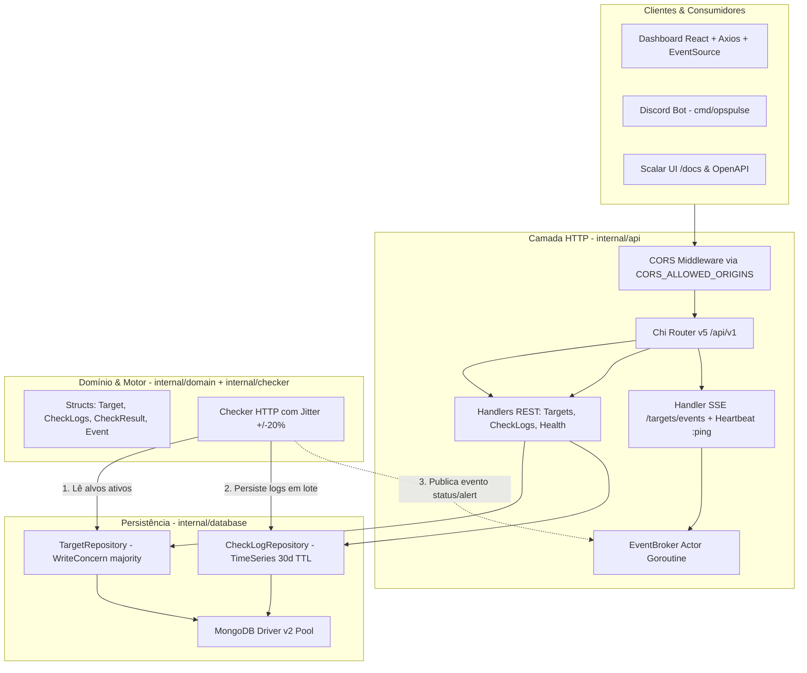
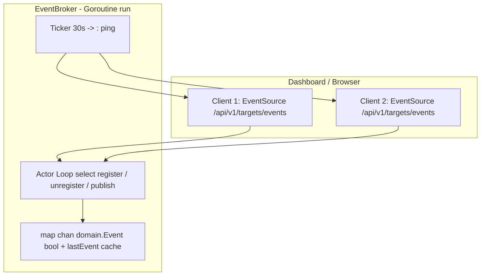
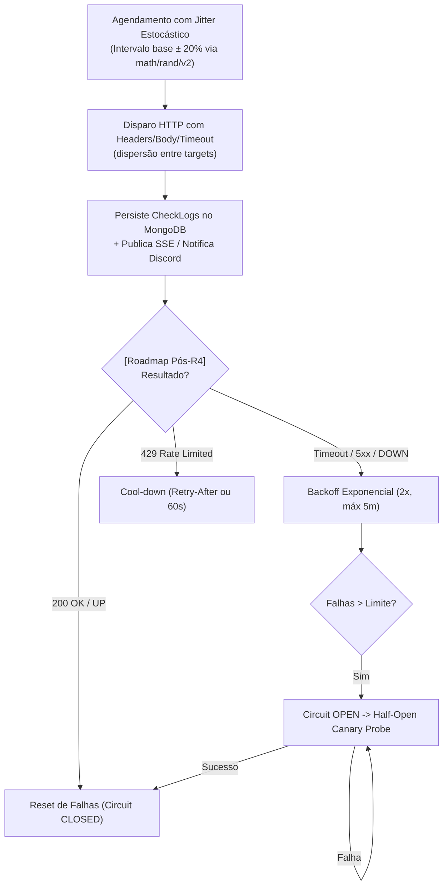
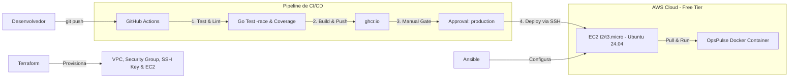

# OpsPulse — Plano Técnico & Arquitetura de Implementação (SDD)

Este plano traduz a especificação (`specs/spec.md`) em arquitetura concreta, decisões técnicas, deltas do código atual e estratégia de verificação para os milestones de implementação (**M2**, **M3**, **M4**) e evolução futura.

---

## 1. Arquitetura do Sistema

### 1.1 Arquitetura da API REST, Streaming SSE & Persistência



### 1.2 Fluxo Interno do `EventBroker` (Actor Model SSE)



- Canais utilizados no `EventBroker`: `clients`, `register`, `unregister`, `publish`, `lastEvent`.
- Ao registrar novo cliente, se houver `lastEvent`, envia imediatamente o último estado (evitar bloqueio caso buffer esteja cheio) para que a UI não fique vazia esperando o próximo ciclo.
- `PrepareSSE` configura `Content-Type: text/event-stream`, `Cache-Control: no-cache`, `Connection: keep-alive`, `X-Accel-Buffering: no`, e **não** deve setar `Access-Control-Allow-Origin: *` hardcoded.

### 1.3 Fluxo do Motor de Monitoramento & Resiliência



### 1.4 Pipeline de Infraestrutura & Deploy (Roadmap Cloud)



---

## 2. Layout de Código e Decisões Arquiteturais

### 2.1 Layout Mantido (Pragmático, sem Over-Engineering — R4)

```text
opspulse/
├── cmd/
│   ├── api/main.go             # API HTTP + SSE + Loop de checagem com MongoDB
│   ├── opspulse/main.go        # Monitor local + Bot Discord com MongoDB
│   └── database/main.go        # Executor de migrations MongoDB
├── internal/
│   ├── api/                    # Chi v5 routes, handlers (targets, check-logs, health, SSE), CORS middleware
│   ├── checker/                # CheckAll, checkURL (Method/Headers/Body/BodyMatch), Jitter ±20%, StartMonitoring
│   ├── config/                 # LoadAppConfig, LoadServerConfig (CORS), LoadDatabaseConfig, LoadMonitorConfig, etc.
│   ├── database/               # MongoClient, interfaces TargetRepository & CheckLogRepository, impls MongoDB, mocks
│   ├── discord/                # Bot Discord (/status, btn_recheck, embeds)
│   ├── domain/                 # Target, CheckLogs/CheckLog, CheckResult, Event, Incident, Errors
│   ├── file/                   # EnvFile (godotenv) + JSON/YAML loaders legados
│   └── logger/                 # log/slog configurado por serviço
├── migrations/                 # 000001_targets, 000002_check_logs (Time-Series 30d TTL), 000003_incidents
├── web/opspulse-frontend/      # React 19 + TypeScript + Tailwind v4 + Axios + Vite
├── deployments/                # compose.dev.yml, compose.prod.yml, terraform/
├── build/                      # Dockerfiles (Go/Vite dev & prod) + ansible/
├── docs/                       # DEVELOPMENT_WORKFLOW.md, SOURCES_DEVELOPEMENT.md, openapi.yaml
└── specs/                      # constitution.md, spec.md, plan.md, tasks.md
```

**Decisão explícita (R4):** Mantemos `internal/database/` + `internal/domain/` + `internal/api/` em vez de criar `internal/storage/mongo/` + `internal/service/`. Os repositórios são injetados diretamente nos handlers e no `checker`/`cmd`, evitando camadas de repasse (*pass-through services*) sem regra de negócio própria. Caso surja lógica de negócio complexa no futuro (ex: OAuth2, cálculo de incidentes/SLA), ela poderá ser isolada pontualmente.

---

## 3. Plano Detalhado por Milestone & Deltas Verificados no Código

### 3.1 Milestone M2 — Persistência MongoDB, Mocks & Checker com Jitter

#### A. Correções & Evoluções em `internal/domain/`
1. **`internal/domain/target.go`:**
   - Adicionar campo `Headers map[string]string` (`json:"headers,omitempty" yaml:"headers,omitempty" bson:"headers,omitempty"`).
2. **`internal/domain/errors.go`:**
   - Adicionar `ErrInvalidInput` e `ErrAlreadyExists` para tratamento limpo de validação e conflito de URL única (`400` / `409` na API).

#### B. Repositórios & Mocks em `internal/database/`
- **Deltas verificados hoje:**
  - `internal/database/repository.go` importa `go.mongodb.org/mongo-driver/mongo` (v1) junto com `v2/bson`, e declara métodos sem corpo com assinaturas incompatíveis com `mock.go` (`FindByID(ctx, id string)`, `Delete(ctx)` sem `id`, `FindAll` sem `limit, offset`).
  - `internal/database/mock.go`: `MockTargetRepository.Create` não atualiza `m.order`, `FindByID` copia ponteiro (`copied := target`), faltam `Delete` e `FindEnabled`; `MockCheckLogRepository` não possui `FindByID` nem filtros.
- **Plano de implementação:**
  1. Unificar imports para `go.mongodb.org/mongo-driver/v2/mongo`, `v2/mongo/options`, `v2/bson`.
  2. Definir structs de filtro `TargetFilter` e `CheckLogFilter` e interfaces completas `TargetRepository` e `CheckLogRepository`.
  3. Implementar `MongoDBTargetRepository` (com `WriteConcern: majority` ou collection options consistentes, índices/tratamento de `IsDuplicateKeyError` -> `domain.ErrAlreadyExists`, `mongo.ErrNoDocuments` -> `domain.ErrNotFound`).
  4. Implementar `MongoDBCheckLogRepository` (`Create`, `CreateBatch` com `InsertMany` e `WriteConcern: 1`, `FindByID`, `FindAll` com filtros dinâmicos e ordenação `checked_at: -1`, `FindByTargetID`).
  5. Completar `MockTargetRepository` e `MockCheckLogRepository` com cópias profundas seguras contra race conditions, `order` consistente, filtros e validação de unicidade de `URL`.
  6. Criar `internal/database/repository_test.go` testando todos os fluxos de `TargetRepository` e `CheckLogRepository` contra os mocks, além de testes de helpers/conversão BSON/filtros sem precisar de MongoDB ativo.

#### C. Motor de Checagem & Jitter em `internal/checker/`
- **Deltas verificados hoje:**
  - `checker.go` usa `http.MethodGet` fixo, ignora `Method`, `Headers`, `Body`, `ExpectedBodyMatch`; `StartMonitoring` usa `time.NewTicker(cfg.Interval)` rígido sem jitter.
- **Plano de implementação:**
  1. Criar função `ApplyJitter(base time.Duration, ratio float64) time.Duration` usando `math/rand/v2` (fator em $[1 - \text{ratio}, 1 + \text{ratio}]$, padrão `0.20`).
  2. Atualizar `checkURL` para aceitar um alvo com `ID` (ou `domain.Target` / helper `CheckTarget`) aplicando `Method`, `Headers`, `Body` JSON, `Timeout`, `ExpectedStatus` e `ExpectedBodyMatch`.
  3. Em `CheckAll` (ou `CheckTargets`), dispersar levemente o início das goroutines com jitter proporcional/aleatório respeitando `ctx.Done()` para evitar disparo simultâneo no mesmo milissegundo.
  4. Em `StartMonitoring`, substituir o ticker fixo por loop com `time.NewTimer(ApplyJitter(interval, 0.20))` recalculado a cada iteração, mantendo suporte a `<-ctx.Done()` e `<-triggerChan`, além de buscar alvos habilitados do `TargetRepository` e persistir logs em lote no `CheckLogRepository`.
  5. Escrever testes unitários em `internal/checker/checker_test.go` validando: distribuição do jitter dentro de $[\text{base} \times 0.8, \text{base} \times 1.2]$, respeito a `Method`/`Headers`/`Body`/`ExpectedBodyMatch`, e cancelamento de contexto via `httptest.NewServer`.

---

### 3.2 Milestone M3 — Migração de `cmd/api` & `cmd/opspulse`, Rotas REST, CORS & OpenAPI

#### A. Configuração (`internal/config/` & `.env.example`)
1. `internal/config/server.go`: adicionar `AllowedOrigins []string` lido de `CORS_ALLOWED_ORIGINS` (default seguro dev `http://localhost:5173,http://localhost:5174`).
2. `internal/config/monitor.go`: remover obrigatoriedade de `MONITOR_TARGETS_FILE` (evitar erro se arquivo local não existir), mantendo `MONITOR_INTERVAL`, `MONITOR_DEFAULT_TIMEOUT`, `AlertThreshold`.
3. `.env.example`: documentar `CORS_ALLOWED_ORIGINS` e `VITE_API_BASE_URL` (ou orientar em `web/opspulse-frontend/.env.example`).

#### B. API HTTP & SSE (`internal/api/`)
1. Corrigir import em `internal/api/server.go`: `github.com/go-chi/chi/v5/middleware`.
2. Atualizar `corsMiddleware(allowedOrigins []string)` (`internal/api/middleware.go`) e `PrepareSSE` (`internal/api/responses.go`) para validar `Origin` contra `ServerConfig.AllowedOrigins` e remover `*` hardcoded.
3. Injetar `database.TargetRepository` e `database.CheckLogRepository` no `api.Server`, `TargetHandler` e `CheckLogHandler`.
4. Implementar rotas REST:
   - `GET /api/v1/targets`, `POST /api/v1/targets`, `GET /api/v1/targets/{id}`, `PUT /api/v1/targets/{id}`, `PATCH /api/v1/targets/{id}`, `DELETE /api/v1/targets/{id}`
   - `GET /api/v1/check-logs`, `GET /api/v1/check-logs/{id}`
   - Atualizar `GET /api/v1/targets/status` e `Server.StartMonitoring` para ler alvos habilitados via `targetRepo.FindEnabled(ctx)` e gravar resultados em `checkLogRepo.CreateBatch(ctx, logs)`.
5. Escrever testes de handlers com `httptest` + `MockTargetRepository` + `MockCheckLogRepository` validando status codes, paginação, filtros, validação de payload, CORS (origem permitida vs bloqueada) e SSE.
6. Regenerar `docs/openapi.yaml` com `make api-docs`.

#### C. Migração de `cmd/opspulse/main.go` & `internal/discord/`
1. Em `cmd/opspulse/main.go`:
   - Conectar `MongoClient` via `database.NewMongoClient(ctx, cfg.Database)` com `defer mongoClient.Close(shutdownCtx)`.
   - Instanciar `MongoDBTargetRepository` e `MongoDBCheckLogRepository`.
   - Passar repositórios para `bot.Setup(...)` e `checker.StartMonitoring(...)` (eliminando uso de `cfg.TargetURLs` carregado de arquivo).
2. Em `internal/discord/bot.go`:
   - Atualizar `Setup` para receber interface/função provedora de targets do repositório (para `/status` e `btn_recheck` consultarem o MongoDB dinamicamente e opcionalmente persistirem o log da checagem sob demanda).

---

### 3.3 Milestone M4 — Frontend (`web/opspulse-frontend/`)

1. **Instalação e Configuração do `axios`:**
   - Instalar `axios` em `web/opspulse-frontend`.
   - Criar `src/lib/api.ts` usando `import.meta.env.VITE_API_BASE_URL` (zero hardcode).
   - Atualizar `src/hooks/useSSE.ts` para usar `VITE_API_BASE_URL` na construção da URL do `EventSource` e adicionar `return () => { es.close(); }` no `useEffect`.
2. **Tipagem (`src/types/`):**
   - Definir tipos TypeScript alinhados aos contratos JSON Go: `Target`, `TargetPayload`, `CheckLog`, `PaginatedResponse<T>`, `CheckLogFilters`, mantendo `CheckResult` para SSE.
3. **Modal de Criação/Atualização de Target (`src/components/TargetModal.tsx`):**
   - Formulário completo conectado a `POST /api/v1/targets` e `PUT /api/v1/targets/{id}`, validação client-side básica, feedback de erro da API e loading state.
4. **Layout em Cards (`src/components/TargetCards.tsx`):**
   - Substituir `TargetTable.tsx` no `DashboardPage` por grid responsivo de cards exibindo dados cadastrais do Target + último status/latência/HTTP code/diagnóstico em tempo real do SSE, além de ações rápidas (Editar, Ativar/Pausar, Excluir, Ver Logs).
5. **Página de Checklogs (`src/pages/CheckLogsPage.tsx`):**
   - Consome `GET /api/v1/check-logs` e `GET /api/v1/targets`.
   - Filtros: target, status UP/DOWN, código HTTP, intervalo temporal (`1h`, `24h`, `7d`, `30d`, custom), busca textual e paginação.
   - Painel de Insights derivado diretamente dos registros retornados (Uptime %, Latência Média/Min/Max/P95, Contagem de Falhas, Distribuição de Status Codes, Top Alvos Lentos/Instáveis) implementado com funções puras em TypeScript sem bibliotecas externas desnecessárias.
6. **Validação:** `npm run lint` (`oxlint`) e `npm run build` (`tsc -b && vite build`).

---

### 3.4 Milestone M6 — Intervalo por Target, Filtros Persistidos & Alvo Mais Rápido

1. **Intervalo Individual por Target (`Target.Interval` + Agendador por Alvo):**
   - Adicionar `Interval time.Duration` (`interval` JSON/BSON/YAML) em `domain.Target`, `TargetRequest`, `PatchTargetRequest`, `MongoDBTargetRepository.Update` e `MockTargetRepository`.
   - Implementar `RunTargetScheduler` em `internal/checker/checker.go` mantendo workers independentes por alvo (`target.Interval` com fallback para `MONITOR_INTERVAL`, jitter $\pm 20\%$ por worker, reconciliação periódica e imediata via canal de sinalização em mutações CRUD da API ou `triggerChan`).
   - Reutilizar `RunTargetScheduler` em `checker.StartMonitoring` (`cmd/opspulse`) e `api.Server.StartMonitoring` (`cmd/api`), mantendo snapshot thread-safe para broadcast SSE.
2. **Filtros de Disponibilidade com `localStorage` na Dashboard:**
   - Adicionar `AvailabilityFilter` (`all`, `up`, `down`, `paused`, `pending`) e helpers de classificação/persistência (`opspulse.dashboard.availabilityFilter`) em `src/lib/targetStatus.ts` e UI em `src/components/TargetCards.tsx`.
3. **Alvo Mais Rápido na Média nos CheckLogs:**
   - Adicionar `fastestTarget: TargetInsightSummary | null` em `src/lib/insights.ts` (menor `avgLatencyMs` entre alvos com latência válida) e exibir destaque dedicado em `src/pages/CheckLogsPage.tsx`.

---

## 4. Plano de Infraestrutura & Deploy (Cloud AWS — Roadmap)

Consolidação operacional para provisionamento em nuvem quando aplicável fora do servidor local:

1. **Conta AWS & IAM:** Ativar MFA no Root, criar *AWS Budgets* (alerta > `$0.01`) + Free Tier alert, usuário IAM com permissões restritas (`AmazonEC2FullAccess`, `AmazonVPCFullAccess`), configurar `aws configure` e validar com `aws sts get-caller-identity`.
2. **Provisionamento Terraform (`deployments/terraform/`):** Gerar chave `ssh-keygen -t ed25519 -f ~/.ssh/opspulse-aws`, configurar `aws_key_pair`, `aws_security_group` (SSH porta `22` restrita ao IP público do operador; outbound `0.0.0.0/0`), `aws_instance` `t2.micro`/`t3.micro` Ubuntu 24.04 LTS, e rodar `terraform init && terraform plan -out=tfplan && terraform apply tfplan`.
3. **Configuração Ansible (`build/ansible/`):** Atualizar `inventory.ini` com IP da EC2 e executar `ansible-playbook -i build/ansible/inventory.ini build/ansible/setup-ec2.yml --private-key ~/.ssh/opspulse-aws` (Docker Engine + Compose, grupo `docker`, `/opt/opspulse`, `ufw`).
4. **CI/CD GitHub Actions:** Configurar secrets (`SSH_PRIVATE_KEY`, `EC2_HOST`, `EC2_USER`, `DISCORD_TOKEN`, `DISCORD_CHANNEL_ID`) e environment `production` com aprovação manual; jobs `test_and_lint` (`go test -v -race ./...` + `golangci-lint`) $\to$ `build_and_push` (`ghcr.io`) $\to$ `deploy` (SSH pull + `restart: unless-stopped`).
5. **Smoke Test em Produção:** `ssh -i ~/.ssh/opspulse-aws ubuntu@<IP_DA_EC2>`, `docker ps`, `docker logs -f opspulse` e `/status` no Discord.
